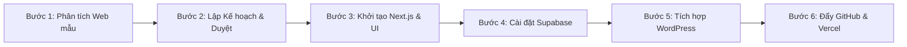

# HƯỚNG DẪN QUY TRÌNH XÂY DỰNG WEBSITE B2B THƯƠNG MẠI ĐIỆN TỬ
## (Next.js App Router + Supabase + Headless WordPress + GitHub + Vercel)

Tài liệu này đóng gói toàn bộ các bước đã triển khai từ đầu đến cuối của dự án mô phỏng **PharmaDi.vn**. Bạn có thể sử dụng quy trình chuẩn này để áp dụng cho bất kỳ dự án web B2B / B2C nào tiếp theo.

---



---

## BƯỚC 1: Khảo Sát & Bóc Tách Công Nghệ Website Mẫu

* **Nội dung:** Tìm hiểu công nghệ cốt lõi của website mục tiêu để chọn kiến trúc tương đồng tối ưu nhất.
* **Câu lệnh người dùng yêu cầu:**
  > *"bạn có thể đọc được mã nguồn trang web này không? https://pharmadi.vn/"*
* **Các việc cần thực hiện:**
  1. Dùng lệnh `curl` tải mã nguồn HTML và các file script tĩnh (JavaScript Chunks) của trang web mục tiêu.
  2. Bóc tách và phát hiện stack công nghệ: Website đang chạy trên **Next.js (React App Router)** kết hợp với **Tailwind CSS**.
  3. Phân định ranh giới kỹ thuật: Xác định phần mã Frontend (HTML/CSS/JS/API client) đọc được và phần mã Backend (database, secret keys) cần thiết kế lại.

---

## BƯỚC 2: Lập Kế Hoạch Kỹ Thuật & Đánh Giá Tính Khả Thi

* **Nội dung:** Thiết kế kiến trúc tổng thể, mô hình dữ liệu (Database Schema), luồng người dùng và lập kế hoạch xét duyệt trước khi viết code.
* **Câu lệnh người dùng yêu cầu:**
  > *"Tôi muốn bạn xây dựng cho tôi một website tương tự website này về kiến trúc kỹ thuật, giao diện. Tôi muốn dùng supabase để quản trị đăng ký/đăng nhập người dùng (authentication); và các bảng cơ sở dữ liệu về sản phẩm, đơn giá...; tôi muốn quản trị việc viết bài và đăng bài bằng wordpress. Tôi muốn đẩy lên github và deploy lên vercel. Hãy đưa cho tôi kế hoạch đầy đủ, đánh giá tính khả thi, để tôi xét duyệt trước khi viết code"*
* **Các việc cần thực hiện:**
  1. Viết tài liệu Kế hoạch kiến trúc (Feasibility Plan) với điểm đánh giá 9.5/10.
  2. Vẽ sơ đồ kiến trúc hệ thống (Mermaid Diagram) kết nối 4 thành phần: Next.js Frontend + Supabase BaaS + Headless WordPress CMS + Vercel Hosting.
  3. Thiết kế sơ đồ quan hệ thực thể (ERD) cho Database: `profiles`, `brands`, `categories`, `products`, `product_tier_prices`, `orders`, `order_items`.
  4. Xác định luồng xác thực (Supabase Auth) và luồng tin tức qua WP REST API.

---

## BƯỚC 3: Tinh Chỉnh Quy Trình Nghiệp Vụ Theo Thực Tế

* **Nội dung:** Chốt các quyết định kinh doanh và phương án kỹ thuật dự phòng trước khi viết code.
* **Câu lệnh người dùng yêu cầu:**
  > *"1) tôi chưa có website wordpress đang hoạt động; 2) không bắt buộc đăng nhập để xem giá sỉ; 3) không cần tích hợp cổng thanh toán trực tuyến"*
* **Các việc cần thực hiện:**
  1. **Giải pháp WordPress:** Xây dựng adapter REST API kèm bộ **Mock Data dự phòng** (để web chạy ngay lập tức khi chưa có hosting WordPress).
  2. **Chính sách giá:** Hiển thị công khai Giá sỉ tốt nhất & Giá niêm yết trên thẻ sản phẩm. Đăng nhập Supabase Auth dùng để lưu lịch sử đơn hàng và tích lũy điểm.
  3. **Thanh toán:** Xây dựng luồng tạo đơn B2B tinh gọn: Hỗ trợ COD + Tự động sinh mã **VietQR** chuẩn ngân hàng.

---

## BƯỚC 4: Khởi Tạo Dự Án Next.js & Cấu Hình Môi Trường

* **Nội dung:** Thiết lập dự án Next.js 14 App Router, Tailwind CSS, TypeScript, Supabase SSR và Lucide Icons.
* **Câu lệnh người dùng yêu cầu:**
  > Phê duyệt kế hoạch: *"Đồng ý"* / *"Bắt đầu"*
* **Các việc cần thực hiện:**
  1. Khởi tạo file `package.json` với các thư viện: `next`, `react`, `react-dom`, `@supabase/ssr`, `@supabase/supabase-js`, `lucide-react`, `tailwindcss`.
  2. Tạo các file cấu hình nền tảng: `tsconfig.json`, `tailwind.config.ts`, `postcss.config.mjs`, `next.config.mjs`.
  3. Cài đặt toàn bộ gói phụ thuộc: `npm install`.
  4. Định nghĩa cấu trúc kiểu dữ liệu TypeScript trong `src/types/index.ts`.

---

## BƯỚC 5: Xây Dựng Giao Diện Chuẩn Mô Hình B2B PharmaDi

* **Nội dung:** Lập trình các component giao diện theo chuẩn thiết kế website thực tế (Desktop & Mobile).
* **Các việc cần thực hiện:**
  1. **Header & Navigation:** 
     - [Header.tsx](file:///c:/Users/admin/Desktop/website/src/components/layout/Header.tsx): Hotline miền Bắc/Nam, logo, thanh tìm kiếm live-search, icon giỏ hàng và nút đăng nhập.
     - [MobileBottomNav.tsx](file:///c:/Users/admin/Desktop/website/src/components/layout/MobileBottomNav.tsx): Thanh điều hướng 5 nút dưới đáy màn hình điện thoại (Trang chủ, Khuyến mãi, Đặt nhanh, Đơn hàng, Tài khoản).
  2. **Trang chủ & Lọc sản phẩm:**
     - [HeroBanner.tsx](file:///c:/Users/admin/Desktop/website/src/components/home/HeroBanner.tsx): Banner đối tác lớn và 4 huy hiệu cam kết.
     - [BrandGrid.tsx](file:///c:/Users/admin/Desktop/website/src/components/home/BrandGrid.tsx): Lưới logo 12 thương hiệu đối tác quốc tế.
     - [CategoryFilters.tsx](file:///c:/Users/admin/Desktop/website/src/components/home/CategoryFilters.tsx): Bộ lọc kép (Tabs Nhóm công dụng + Pills Hoạt chất thành phần).
     - [ProductCard.tsx](file:///c:/Users/admin/Desktop/website/src/components/product/ProductCard.tsx): Thẻ sản phẩm với Giá sỉ, Giá niêm yết, Badge Tích lũy và nút "Nhập sỉ".
  3. **Đặt hàng & Giỏ hàng:**
     - [QuickOrderModal.tsx](file:///c:/Users/admin/Desktop/website/src/components/product/QuickOrderModal.tsx): Bật lên khi bấm "Nhập sỉ", tính tổng tiền và chiết khấu tức thì.
     - [CartDrawer.tsx](file:///c:/Users/admin/Desktop/website/src/components/cart/CartDrawer.tsx): Form tạo đơn hàng B2B, lưu đơn và sinh mã VietQR thanh toán.
  4. **Quản trị người dùng & Tin tức:**
     - [AuthModal.tsx](file:///c:/Users/admin/Desktop/website/src/components/auth/AuthModal.tsx): Đăng ký/đăng nhập Nhà thuốc + Nút demo login 1-click.
     - [KnowledgeSection.tsx](file:///c:/Users/admin/Desktop/website/src/components/home/KnowledgeSection.tsx): Khối hiển thị bài viết y dược.
     - [Footer.tsx](file:///c:/Users/admin/Desktop/website/src/components/layout/Footer.tsx): Thông tin pháp lý, Bộ Công Thương, hotline.

---

## BƯỚC 6: Cài Đặt Cơ Sở Dữ Liệu & Xác Thực Trên Supabase

* **Nội dung:** Kết nối dự án với Supabase, khởi tạo toàn bộ bảng, phân quyền bảo mật RLS và nạp dữ liệu mẫu.
* **Câu lệnh người dùng yêu cầu:**
  > *"Tôi đã tạo một project mới, hãy cài đặt hết cho tôi. https://aueidwbtfcekdbkwrdvf.supabase.co"*
  > Sau đó gửi `anon key` và thông báo *"done"* (đã chạy SQL).
* **Các việc cần thực hiện:**
  1. Soạn thảo file [supabase/seed.sql](file:///c:/Users/admin/Desktop/website/supabase/seed.sql) chứa:
     - Câu lệnh `CREATE TABLE` cho các bảng: `profiles`, `brands`, `categories`, `products`, `orders`, `order_items`.
     - Kích hoạt bảo mật **Row Level Security (RLS)** cho phép người dùng xem công khai và tạo đơn hàng an toàn.
     - Trigger tự động đồng bộ tài khoản `auth.users` sang bảng `profiles`.
     - Lệnh `INSERT` nạp sẵn 12 thương hiệu, 20 danh mục và 8 sản phẩm mẫu thực tế của PharmaDi.
  2. Người dùng mở **Supabase $\rightarrow$ SQL Editor**, dán toàn bộ file `seed.sql` và bấm **RUN**.
  3. Lấy khóa **`anon public key`** trong **Project Settings $\rightarrow$ API** điền vào [.env.local](file:///c:/Users/admin/Desktop/website/.env.local).
  4. Chạy kiểm tra kết nối từ script Node.js: Xác nhận truy vấn thành công dữ liệu từ database cloud.

---

## BƯỚC 7: Kết Nối Headless WordPress CMS (Mục Tri Thức)

* **Nội dung:** Tạo site WordPress miễn phí và kết nối API để quản trị viên viết bài đăng lên website Next.js.
* **Câu lệnh người dùng yêu cầu:**
  > *"Sau khi đã cài đặt supabase xong, hướng dẫn tôi tạo tài khoản wordpress"*
  > Sau đó gửi link: *"https://tranquyet5.wordpress.com"*
* **Các việc cần thực hiện:**
  1. Hướng dẫn người dùng đăng ký trang miễn phí trên **WordPress.com** (tên miền dạng `...wordpress.com`).
  2. Người dùng viết bài thử nghiệm trên giao diện WordPress Gutenberg.
  3. Nâng cấp module [client.ts](file:///c:/Users/admin/Desktop/website/src/lib/wordpress/client.ts) để tự động phát hiện endpoint WordPress.com (`https://public-api.wordpress.com/wp/v2/sites/<domain>/posts`).
  4. Điền URL WordPress vào [.env.local](file:///c:/Users/admin/Desktop/website/.env.local):
     ```env
     NEXT_PUBLIC_WORDPRESS_API_URL=https://tranquyet5.wordpress.com
     ```
  5. Xây dựng trang danh sách bài viết `/tri-thuc` và chi tiết bài viết `/tri-thuc/[slug]`.
  6. Kiểm tra: Bài viết thực tế "test" và "Hello World!" của tác giả tự động hiển thị mượt mà trên Next.js với bộ đệm ISR.

---

## BƯỚC 8: Đóng Gói Git & Tự Động Đẩy Lên GitHub

* **Nội dung:** Thiết lập Git cục bộ an toàn, xác thực tài khoản GitHub và tự động đẩy mã nguồn lên kho chứa.
* **Câu lệnh người dùng yêu cầu:**
  > *"tôi đã có tài khoản github, bạn hãy push dự án này lên"*
  > Sau đó yêu cầu: *"tự làm đi"*
* **Các việc cần thực hiện:**
  1. Cài đặt **MinGit** và **GitHub CLI (`gh`)** không cần quyền quản trị viên phức tạp.
  2. Tạo file [.gitignore](file:///c:/Users/admin/Desktop/website/.gitignore) nghiêm ngặt để loại trừ `node_modules`, `.next`, và quan trọng nhất là file chứa mã bí mật `.env.local`.
  3. Khởi tạo Git repo (`git init`), cấu hình nhánh chính `main` và commit toàn bộ 37 file mã nguồn.
  4. Chạy lệnh đăng nhập tự động: `gh auth login --web` sinh mã Device Code 8 chữ số.
  5. Người dùng truy cập [https://github.com/login/device](https://github.com/login/device), nhập mã xác thực và cấp quyền.
  6. Chạy lệnh tự động tạo kho và đẩy mã:
     ```bash
     gh repo create pharmadi-web --public --source=. --remote=origin --push
     ```
  7. Kết quả: Kho mã nguồn chính thức được tạo tại: **[https://github.com/tranquyetta195-hue/pharmadi-web](https://github.com/tranquyetta195-hue/pharmadi-web)**.

---

## BƯỚC 9: Triển Khai (Deploy) Lên Vercel & Bàn Giao

* **Nội dung:** Đưa website lên mạng Internet toàn cầu với CI/CD tự động và chứng chỉ SSL miễn phí.
* **Các việc cần thực hiện:**
  1. Đăng nhập [vercel.com](https://vercel.com) bằng tài khoản GitHub vừa kết nối.
  2. Bấm **Add New... $\rightarrow$ Project**, chọn repository `pharmadi-web` và bấm **Import**.
  3. Cấu hình 3 biến môi trường (Environment Variables) sao chép từ `.env.local`:
     * `NEXT_PUBLIC_SUPABASE_URL`
     * `NEXT_PUBLIC_SUPABASE_ANON_KEY`
     * `NEXT_PUBLIC_WORDPRESS_API_URL`
  4. Bấm **Deploy**. Vercel tự động build và cấp domain chính thức (ví dụ: `https://pharmadi-web.vercel.app`).
  5. Kể từ lúc này, mỗi khi bạn chỉnh sửa mã nguồn và đẩy lên GitHub, Vercel sẽ tự động cập nhật website mới mà không cần thao tác thủ công.

---

## 📌 Checklist Tóm Tắt Khi Bắt Đầu Một Dự Án Mới

| Thứ tự | Hạng mục công việc | File / Công cụ tương ứng |
| :---: | :--- | :--- |
| **1** | Khởi tạo Next.js App Router + Tailwind CSS | `package.json`, `tsconfig.json`, `tailwind.config.ts` |
| **2** | Định nghĩa cấu trúc Types | `src/types/index.ts` |
| **3** | Tạo Database Schema & Seed Data | File SQL tương tự `supabase/seed.sql` chạy trong Supabase SQL Editor |
| **4** | Cấu hình Supabase Client & Service | `@supabase/ssr`, `src/lib/supabase/client.ts`, `service.ts` |
| **5** | Cấu hình Headless WordPress Client | `src/lib/wordpress/client.ts` kết nối WP REST API |
| **6** | Thiết lập Cart & Auth Context | `CartContext.tsx` (B2B Quick Order), `AuthContext.tsx` |
| **7** | Lắp ghép UI Components | Header, Banner, Filters, Product Cards, Cart Drawer |
| **8** | Tạo file `.gitignore` an toàn | Loại trừ `.env.local`, `node_modules` |
| **9** | Đẩy lên GitHub qua GitHub CLI | `gh repo create <repo-name> --public --source=. --remote=origin --push` |
| **10** | Import Vercel & điền Environment Variables | Vercel Project Settings $\rightarrow$ Environment Variables $\rightarrow$ Deploy |
